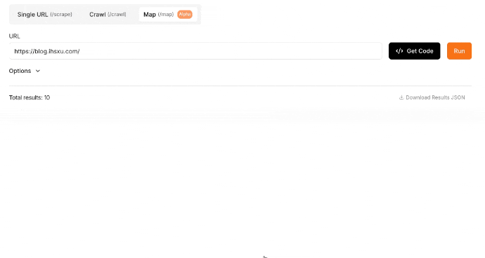
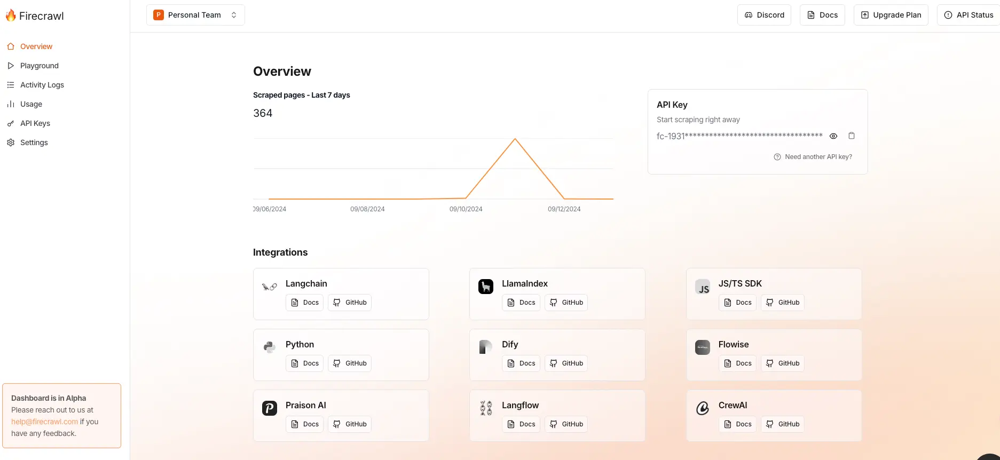
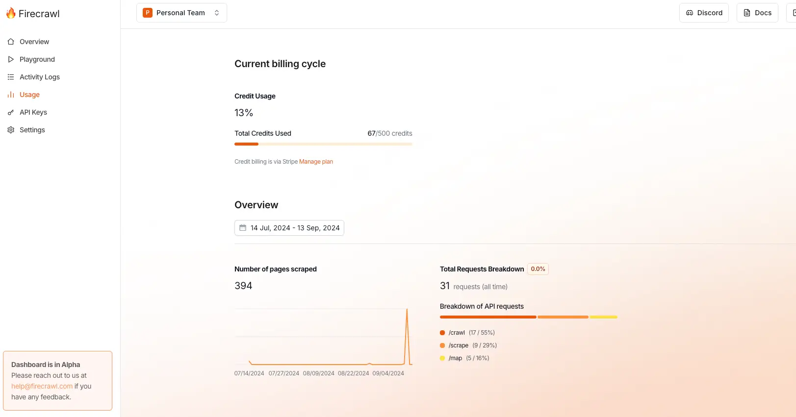
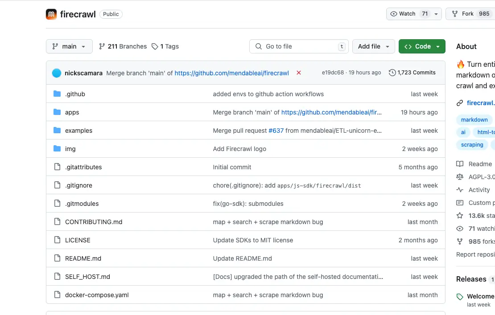
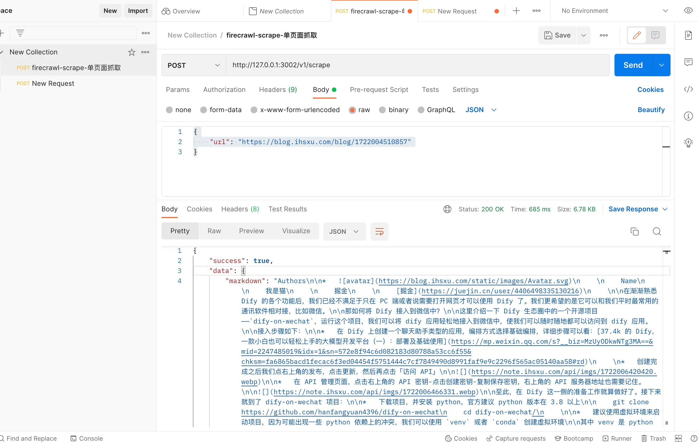
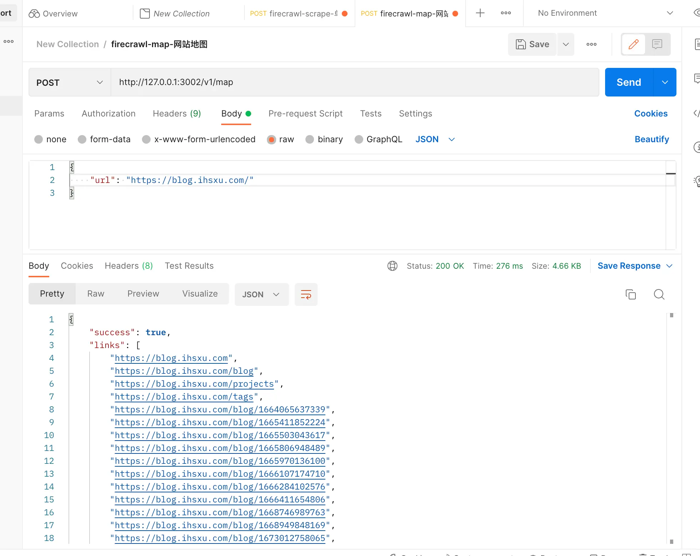
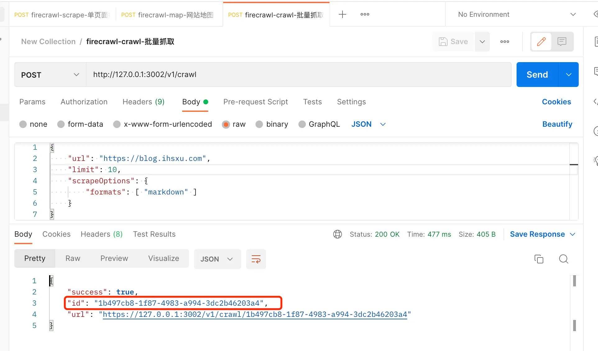
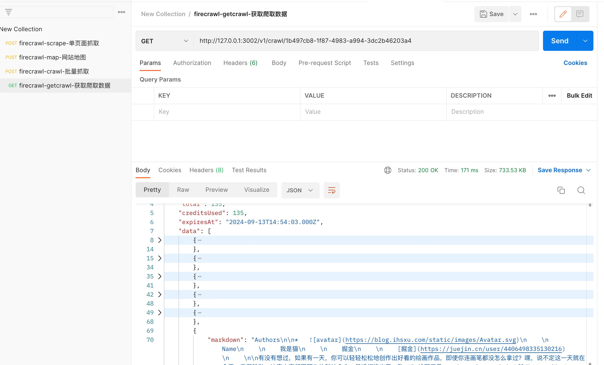

哈咯～大家好，我是三金。

之前在《[38.2k 的 AI 开发平台 Dify 教程三：将 Notion 和网站作为知识库](https://mp.weixin.qq.com/s?__biz=MzUyODkwNTg3MA==\&mid=2247485086\&idx=1\&sn=16ffa7b2459ec604c9c0ce2c1ee31173\&chksm=fa68657fcd1fec69d4246d6271bafe0e0119a7c2731ad3049d258f7c3de722b864a05c0f6f3f#rd)》文章中提到了 Dify 的「同步 Web 站点」功能，它主要是通过咱们今天要介绍的**爬虫产品——Firecrawl**来实现的。

#### 什么是 Firecrawl？

Firecrawl 是一款**可以将网站转换为 Markdown 格式的爬虫工具**，主要**提供 API 服务**，无需站点地图，只需要接收一个 URL 地址就可以爬取网站及网站下可访问的所有子页面内容。

与传统爬虫工具相比，**Firecrawl 很擅长处理 JavaScript 动态生成的网站**，即使用类似 Vue 和 React 等前端框架搭建的网站。

#### 功能演示

##### Scrape

**Scrape API 只能抓取单个网页的内容**，主要通过输入需要爬取的 URL 即可将该网页转换为 Markdown，非常适合 LLM 应用。

##### Crawl

**Crawl API 可以抓取整个站点的页面**，只需要给一个 Home 页地址，Firecrawl 就可以开始爬取该网站下的所有子页面，默认的最大抓取页面数是 10，最大爬取深度是 2，这些都可以通过设置 API 参数来进行修改。

**Crawl API 并不会返回爬取的结果，而是返回一个爬取任务 ID**，我们可以通过调用`/crawl/{task_id}`的 API 来获取实际的爬取数据。

##### Map

**Map API 可以用来获取网站地图**，只需要输入一个基本的 URL 即可，它会返回能抓取到的绝大多数链接。



#### 使用线上产品

我们可以访问 Firecrawl 的[官网](https://www.firecrawl.dev/)来体验它。


如图，**点击「Start for free(500 credits)」进入到 Firecrawl 提供的演练场进行体验**。三种功能在上面已经介绍过，就不再赘述。

在注册登录之后，会进入到个人的概览页面，在这里能看到你的**API Key 和 7 天爬取日志**：



**在 Usage 页面可以看到积分使用情况**：



有了 API Key 之后我们就可以将其集成到一些应用中，比如 Dify、Langchain 以及 LlamaIndex 等等。

但是需要注意的是，Firecrawl API 并不是免费使用的，新注册的用户会得到 500 积分，如果这 500 积分用完了，就需要购买他们的服务，Firecrawl 的收费如下：


#### 本地部署

如果没有条件使用付费产品，我们也可以选择本地部署 Firecrawl。

访问 Firecrawl 的[Github](https://github.com/mendableai/firecrawl)并点击查看「[CONTRIBUTING.md](https://github.com/mendableai/firecrawl/blob/main/CONTRIBUTING.md)」文件：



在这个文件中介绍了如何在本地启动一个 Firecrawl 服务：

1. 拉取源码到本地
2. 安装依赖
3. 配置`.env`文件，这个用来设置环境变量
4. 需要跑三个服务：redis、workers（负责处理爬虫任务） 和主服务

三个服务全都开启之后，我们访问主服务进行测试，默认是 3002 端口：

```shellscript
curl -X GET http://localhost:3002/test
```

只要返回响应是 Hello, world! 就表明本地 Firecrawl 启动成功了。

不过由于这个部署流程还依赖一些环境及工具，比如要安装 node、安装 pnpm，每次启动时还需要跑三个服务，比较麻烦，所以三金**推荐大家直接使用 docker compose 来进行部署**。

在项目根目录下作者已经提供了`docker-compose.yaml`文件，我们只需要在`.env`文件中设置好环境变量，然后直接启动即可：

```shellscript
docker compose up -d
```

部署完之后，我们可以用 Postman 来测试一下:



单页爬取没有问题，再测试一下 crawl 和 map API：



crawl API 会返回一个任务 ID，我们需要拿这个任务 ID 来查询最终的爬取结果：



爬取结果如下：



OK～完美，有需要的小伙伴可以在本地部署试试看，结合 AI 知识库就很香～～
